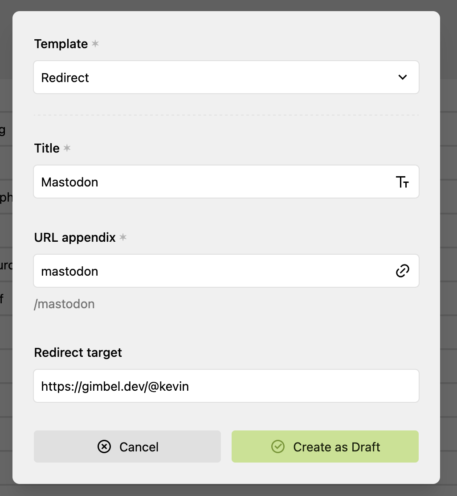
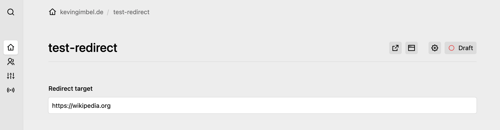

# kirby-redirect
> Setup redirect URLs for your Kirby site from the Admin Panel.

See my [blogpost about the why and how](https://kevingimbel.de/blog/redirect-link-page-template-for-kirby)

<!-- BEGIN mktoc {"min_depth": 2} -->

- [Installation](#installation)
- [Usage](#usage)
- [Screenshots](#screenshots)
- [Contributing](#contributing)
  - [Just commands](#just-commands)
- [License](#license)
<!-- END mktoc -->


## Installation

1. Clone or copy the source code of this repository to `site/plugins/kirby-redirect`
2. Done

## Usage

1. Create a new page with the `Redirect` template
2. Add Title and Redirect target URL
3. Click create
4. That's it ✨

Visiting the new page now redirect to the target page

## Screenshots

New Page creation screen showing the title, URL, and redirect target field



Single page view showing the target input and nothing else


## Contributing

Contributions are very welcome! Dev Tools can be setup with nix and a nix-shell by running

```sh
nix develop
```

### Just commands

All just commands assume they are run in the nix-shell environment.

|Command|Description|
|---|---|
|`just dev`|Enter nix dev shell|
|`just validate`|Run `php -l` against php files for PHP 8.3, 8.4 and 8.5|
|`just toc`|Update the Table of Contents|
```

## License

See LICENSE.md
